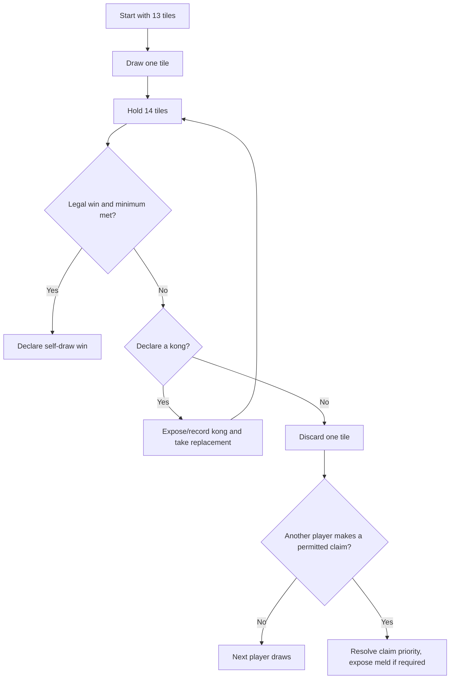
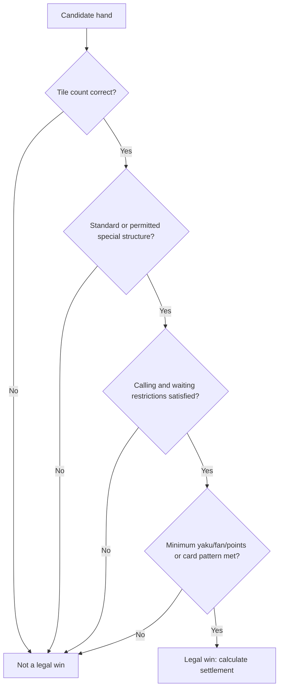

# Mahjong Fundamentals: Complete Play Guide

> **Language:** English | **Scope:** shared four-player foundation

Mahjong is a family of games, not one universal ruleset. This chapter teaches
the common mechanical core. A regional guide must still supply the legal-hand
minimum, scoring table, special tiles, draw settlement, and dealer rules.

## 1. Tile inventory

| Family | Tiles | Calculation |
|---|---:|---|
| Characters | 36 | numbers 1-9, four copies each |
| Bamboo | 36 | numbers 1-9, four copies each |
| Dots | 36 | numbers 1-9, four copies each |
| Winds | 16 | East, South, West, North; four each |
| Dragons | 12 | Red, Green, White; four each |
| **Standard core** | **136** | `3 x 36 + 16 + 12` |
| Flowers and Seasons | usually 0 or 8 | bonus tiles in rules that use them |

A 144-tile set is the 136-tile core plus eight Flowers/Seasons. Some variants
remove honors; others add Animals, Jokers, or Vietnamese special tiles.

## 2. Legal building blocks

| Name | Shape | Example | Restrictions |
|---|---|---|---|
| Sequence / chow | 3 consecutive suited tiles | Bamboo `3-4-5` | no Winds or Dragons |
| Triplet / pung | 3 identical tiles | three Red Dragons | any ordinary tile |
| Quad / kong | 4 identical tiles | four Dot 8 | requires replacement draw |
| Pair | 2 identical tiles | two East Winds | normally exactly one in a standard win |

### Standard winning formula

Let `M` be a legal sequence, triplet, or quad, and `P` a pair:

```text
standard win = M + M + M + M + P
group count  = 4 melds + 1 pair
```

The visible tile count is normally 14. Each kong adds one physical tile, but
still counts as one meld; its replacement draw keeps play balanced.

```text
physical tiles in winning hand = 14 + number_of_kongs
structural groups remain       = 4 melds + 1 pair
```

Taiwanese and some Filipino 16-tile systems instead use:

```text
five melds + one pair; 17 physical tiles at the winning moment
```

Special hands such as seven pairs, thirteen orphans, or an annual American
Mah Jongg hand override the standard formula only when that ruleset says so.

## 3. Setup

1. Confirm the exact variant and score sheet.
2. Select only the tiles that variant uses.
3. Determine seats and dealer (East).
4. Shuffle face down and build the wall according to the variant.
5. Deal 13 tiles to each player in a standard 13-tile system; East receives or
   draws the fourteenth and discards first.

Automated tables may build and raise the wall, but they do not decide which
regional scoring rules the players intended.

## 4. One turn



A player who claims a discard for a sequence or triplet usually exposes that
meld and then discards without first drawing. Exact timing and robbing-a-kong
rules belong to the selected variant.

## 5. Typical claim rules

| Claim | Typical source | Result |
|---|---|---|
| Chow | discard of player immediately before you | expose a sequence, then discard |
| Pung | discard by any opponent | expose a triplet, then discard |
| Kong | discard or own matching tile, depending on kong type | declare, draw replacement, continue |
| Win | qualifying discard by an opponent | end or continue according to variant |

Win normally outranks kong/pung, which outrank chow. Multiple-win and closest-
player priority differ, so the host must state them before play.

## 6. Hand-validity test

Use this order; stopping after “four melds and a pair” causes many false wins.



## 7. Scoring model: never mix systems

Mahjong score has three separate layers:

```text
pattern score = value of recognized hand features
hand value    = ruleset-specific conversion(pattern score, hand state)
settlement    = payment rule(hand value, dealer, self-draw/discard, bonuses)
```

| Ruleset | Pattern layer | Conversion example |
|---|---|---|
| MCR | points, normally minimum 8 before Flowers | official pattern addition and exclusions |
| Hong Kong | fan | table fan-to-payment schedule |
| Riichi | han + fu | base points and limit tiers |
| American Mah Jongg | annual card hand value | current card and joker restrictions |
| Sichuan / local China | local fan or multipliers | named table/platform sheet |

A scoring formula is meaningful only after the ruleset is named. Regional
chapters provide formulas when a stable published baseline exists and otherwise
give a worksheet for the host's score table.

## 8. Worked structural example

| Group | Tiles |
|---|---|
| Sequence 1 | Characters `2-3-4` |
| Sequence 2 | Characters `6-7-8` |
| Sequence 3 | Dots `3-4-5` |
| Triplet | three Red Dragons |
| Pair | two Bamboo 7 |

This is structurally `4 melds + 1 pair`. It is not automatically a legal win:
MCR still needs its point minimum, riichi needs a yaku, Hong Kong may require a
fan minimum, and another table may prohibit or value the hand differently.

## 9. Before the first deal

| Decide | Record |
|---|---|
| Variant/version | e.g. WRC 2025 riichi, NMJL 2026, local Changsha sheet |
| Tiles | honors, Flowers, Animals, Jokers, removed suit |
| Legal minimum | yaku, fan, points, or annual card |
| Claims | chow direction, multiple wins, kong rules |
| Settlement | dealer, self-draw, discard responsibility, draw |
| Penalties | false win, exposed dead hand, wrong tile count |

## Sources

- [Pagat: Mahjong](https://www.pagat.com/rummy/mahjong.html)
- [World Riichi Championship rules](https://www.worldriichi.org/wrc-rules)
- [National Mah Jongg League](https://www.nationalmahjonggleague.org/)
