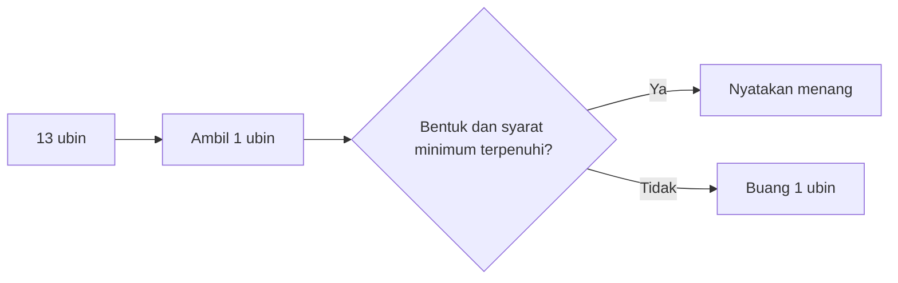

# Mahjong di Indonesia: panduan aturan komunitas

[English version](../31-indonesian-mahjong.md) · [Mahjong fundamentals](../00-mahjong-basics.md)

Tidak ada satu tabel skor nasional yang dapat dianggap berlaku untuk semua meja
di Indonesia. Komunitas dapat memakai keluarga aturan Tionghoa, Hong Kong,
Taiwan, Jepang, atau aturan klub sendiri.

| Istilah | Penjelasan |
|---|---|
| `chow / chi` | tiga angka berurutan dalam satu jenis |
| `pung / pong` | tiga ubin identik |
| `kong` | empat ubin identik dengan prosedur ubin pengganti |
| `fan` | unit nilai menurut tabel yang dipilih, bukan nilai universal |
| `meld` | satu kelompok legal yang sudah terbentuk |

```text
bentuk menang standar = 4 kelompok + 1 pasang
jumlah ubin fisik = 14 + jumlah kong
```



Catat sebelum bermain: ubin yang digunakan, Flower/bonus, arah panggilan,
minimum fan, aturan menang ganda, dealer, seri, dan contoh pembayaran lengkap.

Sumber: [Pagat Mahjong](https://www.pagat.com/rummy/mahjong.html).

INEAN PLAY: [ineanplay.com](https://ineanplay.com/) · [WhatsApp](https://wa.me/8617378390199)

