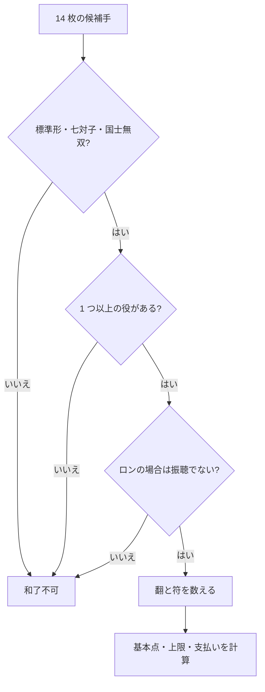

# 日本リーチ麻雀: WRC 2025 基準の遊び方と点数計算

[English guide](../04-japanese-riichi-2025.md)

## 用語対応

| 日本語 | ローマ字 | 説明 |
|---|---|---|
| 立直 | `riichi` | 門前聴牌で供託して行う宣言 |
| 振聴 | `furiten` | 自分の捨て牌や見逃しによりロンできない状態 |
| 飜 | `han` | 役とドラによる価値の単位。香港麻雀の fan と同一換算ではない |
| 符 | `fu` | 待ち・面子・雀頭などから計算する基本点要素 |
| 和了 | `agari / hora` | 規則上有効なツモまたはロン |

## 基本構造

136 枚を使い、通常は花牌を使いません。標準形は `4 面子 + 1 雀頭`、
特殊形として七対子と国士無双があります。和了には最低 1 翻の**役**が必要で、
ドラだけでは和了できません。

| 宣言 | 出所 | 主な結果 |
|---|---|---|
| チー | 上家の捨て牌のみ | 順子を公開 |
| ポン | 誰の捨て牌でも可 | 刻子を公開 |
| カン | 種類により手牌・捨て牌 | 嶺上牌、ドラ表示等を処理 |
| ロン | 条件を満たす他家の牌 | 振聴でないことが必要 |
| ツモ | 自分の摸牌 | 全員が支払う |

門前で聴牌しているプレイヤーは 1000 点棒を出し、捨て牌を横向きにして
リーチを宣言できます。宣言後の選択は制限されます。

## 振聴の確認

自分の捨て牌に現在の待ち牌が含まれる場合、原則としてロンできません。
和了可能な捨て牌を見逃した場合は一時振聴、リーチ後なら原則その局の間
ロンできません。振聴でもツモ和了は可能です。

## 基本点の式

満貫未満では次の基本点を使い、支払いは 100 点単位に切り上げます。

```text
基本点 = 符 x 2^(翻 + 2)
```

| 和了 | 支払いの元になる倍率 |
|---|---|
| 子のロン | `基本点 x 4` |
| 親のロン | `基本点 x 6` |
| 子のツモ | 親 `基本点 x 2`、子 `基本点 x 1` |
| 親のツモ | 各子 `基本点 x 2` |

基本点が 2000 を超える場合や、翻数が満貫以上の条件に達する場合は、WRC
2025 の満貫・跳満・倍満・三倍満・役満の規定を使用します。場ゾロ、
本場、供託、責任払いも規則書に従います。

### 計算例

子が 30 符 3 翻をロンした場合：

```text
基本点 = 30 x 2^(3+2) = 960
ロン点 = 960 x 4 = 3840
100 点単位に切り上げ = 3900
```

## 和了確認フロー



基準資料：[WRC Rules 2025](https://www.worldriichi.org/wrc-rules)。赤ドラ、
途中流局、複数ロンなどは大会・雀荘・アプリの規定を確認してください。
