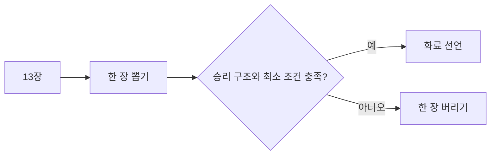

# 한국 마작: 지역 규칙 확인과 기본 진행

[English version](../14-korean-mahjong.md) · [공통 기본 규칙](../00-mahjong-basics.md)

한국 마작에는 하나의 전국 공인 점수표가 있다고 가정하면 안 됩니다. 모임에
따라 중국식 또는 일본식 요소, 꽃패, 최소 점수와 선언 규칙이 달라집니다.

| 용어 | 로마자/원어 | 뜻 |
|---|---|---|
| 치 | `chi / chow` | 같은 수패의 연속 3장 |
| 퐁 | `pon / pung` | 같은 패 3장 |
| 깡 | `kan / kong` | 같은 패 4장, 보충패 절차 필요 |
| 화료 | `agari / hora` | 규칙상 유효한 승리 |
| 후리텐 | `furiten` | 일본식 규칙에서 론을 제한하는 상태 |

후리텐, 도라, 리치가 모두 사용될 때만 일본 리치 규칙으로 계산합니다. 용어를
일부 사용한다는 이유만으로 WRC 점수식을 적용해서는 안 됩니다.

```text
일반 승리 구조 = 4개 몸통 + 1개 머리
실물 패 수 = 14 + 깡 수
```



게임 전에 꽃패, 치 허용 방향, 최소 점수, 리치/도라/후리텐, 친 연장과 유국
정산을 기록하십시오.

출처: [Pagat Mahjong](https://www.pagat.com/rummy/mahjong.html).
