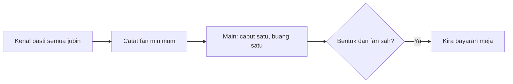

# Mahjong Malaysia empat pemain: panduan meja dan istilah

[English version](../28-malaysian-four-player.md) · [Asas Mahjong](../00-mahjong-basics.md)

Mahjong Malaysia berbeza mengikut komuniti, bahasa dan lokasi. Jangan campurkan
peraturan empat pemain dengan Mahjong Malaysia tiga pemain, yang mungkin
menggunakan set jubin yang dikurangkan.

| Istilah asal | Sebutan/erti praktikal |
|---|---|
| `chow / chi` | siri tiga jubin nombor; biasanya dari pemain di kiri |
| `pung / pong` | tiga jubin yang sama |
| `kong` | empat jubin yang sama dan cabutan gantian |
| `fan` | unit nilai meja; bukan formula sejagat |
| `Animal tiles` | jubin bonus seperti Cat-Rat atau Rooster-Centipede |

```text
bentuk biasa menang = 4 meld + 1 pasangan
bilangan fizikal = 14 + bilangan kong
```

Jubin Animal, Flower dan Season biasanya didedahkan dan diganti, tetapi bayaran
serta hubungan “menangkap” bergantung pada meja.



Sebelum bermain, sahkan set jubin, fan minimum, bayaran segera, had maksimum,
multi-win, dealer dan maksud setiap jubin bonus.

Sumber: [Mahjong Huat](https://www.mahjonghuat.com/rules),
[Animal tiles](https://promlogo.com/mahjong-animal-tiles-variants-of-mahjong/).

INEAN PLAY: [ineanplay.com](https://ineanplay.com/) · [WhatsApp](https://wa.me/8617378390199)

