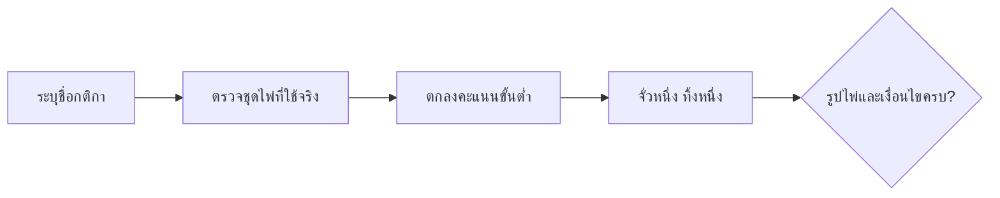

# ไพ่นกกระจอกในประเทศไทย: คู่มือระบุกติกาของโต๊ะ

[English version](../30-thai-mahjong.md) · [Mahjong fundamentals](../00-mahjong-basics.md)

แหล่งข้อมูลที่ใช้ไม่ได้ยืนยันว่ามีกติกาคะแนนระดับชาติแบบเดียวสำหรับทุกโต๊ะใน
ประเทศไทย โต๊ะหนึ่งอาจใช้กติกาฮ่องกง ไต้หวัน ญี่ปุ่น จีนท้องถิ่น หรือกติกาของชมรม

| คำเดิม | คำอ่าน/ความหมายที่จำเป็น |
|---|---|
| `chow / chi` | เชา/ชี่: ไพ่เลขเรียงกัน 3 ใบในชุดเดียวกัน |
| `pung / pong` | พัง/พง: ไพ่เหมือนกัน 3 ใบ |
| `kong` | กง: ไพ่เหมือนกัน 4 ใบและต้องทำขั้นตอนจั่วทดแทน |
| `fan` | ฟาน: หน่วยค่าตามตารางของโต๊ะ ไม่ใช่คะแนนสากล |
| `meld` | ชุดไพ่ที่จัดได้ถูกต้องหนึ่งชุด |

```text
รูปชนะมาตรฐาน = 4 ชุด + 1 คู่
จำนวนไพ่จริง = 14 + จำนวนกง
```



ก่อนเริ่มต้องถามชื่อกติกา จำนวนไพ่ในมือ ดอกไม้/ไพ่พิเศษ การเรียกไพ่ คะแนนขั้นต่ำ
เจ้ามือ การเสมอ และตัวอย่างการจ่ายคะแนนหนึ่งมือเต็ม

แหล่งข้อมูล: [Pagat Mahjong](https://www.pagat.com/rummy/mahjong.html).
