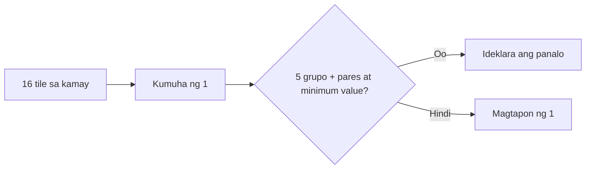

# Filipino Mahjong: gabay sa 16-tile na mesa

[English version](../13-filipino-mahjong.md) · [Mahjong fundamentals](../00-mahjong-basics.md)

Maraming Filipino table ang gumagamit ng 16-tile hand. Ibig sabihin, ang
karaniwang panalong istruktura ay limang grupo at isang pares, hindi apat na
grupo at isang pares.

| Katawagan | Paliwanag |
|---|---|
| `chow / chi` | tatlong sunod-sunod na numero sa iisang suit |
| `pung / pong` | tatlong magkaparehong tile |
| `kong` | apat na magkaparehong tile at replacement draw |
| `meld` | isang kumpletong legal na grupo |
| `fan / tai` | lokal na unit ng halaga; kailangang may score sheet |

```text
karaniwang Filipino 16-tile win = 5 meld + 1 pair
pisikal na tile sa panalo = 17 + bilang ng kong
```



Hindi iisa ang scoring ng lahat ng Filipino table. Linawin ang Flower, special
hands, agarang bayad, chow direction, self-draw, dealer at draw settlement.

Source: [Pagat Mahjong](https://www.pagat.com/rummy/mahjong.html).

INEAN PLAY: [ineanplay.com](https://ineanplay.com/) · [WhatsApp](https://wa.me/8617378390199)
