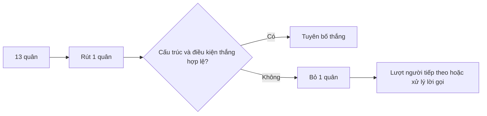

# Mạt chược Việt Nam: hướng dẫn bàn chơi và thuật ngữ

[English version](../11-vietnamese-mahjong.md) · [Mahjong fundamentals](../00-mahjong-basics.md)

Không có một bảng điểm duy nhất cho mọi bàn mạt chược Việt Nam. Bộ bài có thể
gồm 144 quân cơ bản và các quân đặc biệt bổ sung; trước khi chia bài phải xác
nhận chính xác quân nào được sử dụng và tác dụng của từng quân.

| Thuật ngữ gốc | Cách hiểu trong hướng dẫn này |
|---|---|
| `chow / chi` | bộ ba số liên tiếp cùng chất; thường chỉ gọi từ người bên trái |
| `pung / pong` | ba quân giống nhau |
| `kong` | bốn quân giống nhau và thường phải rút quân bù |
| `meld` | một bộ hợp lệ đã hoàn thành |
| `fan` | đơn vị giá trị theo bảng địa phương; không phải điểm chung toàn cầu |

## Cấu trúc thắng thông thường

```text
4 bộ hợp lệ + 1 đôi = cấu trúc 14 quân
số quân thực tế = 14 + số kong
```

Quân đặc biệt Việt Nam không tự động thay thế quân thường. Chủ bàn phải giải
thích tên, số lượng, thời điểm lật, cách rút bù và giá trị của từng loại.



| Phải xác nhận | Nội dung |
|---|---|
| Bộ quân | 144 quân hay có thêm quân đặc biệt |
| Tay bài | 13/14 hay biến thể khác |
| Điều kiện thắng | điểm/fan tối thiểu và tay đặc biệt |
| Thanh toán | tự rút, người bỏ quân, nhà cái và hòa |

Nguồn tổng quan: [Pagat Mahjong](https://www.pagat.com/rummy/mahjong.html).

INEAN PLAY: [ineanplay.com](https://ineanplay.com/) · [WhatsApp](https://wa.me/8617378390199)

