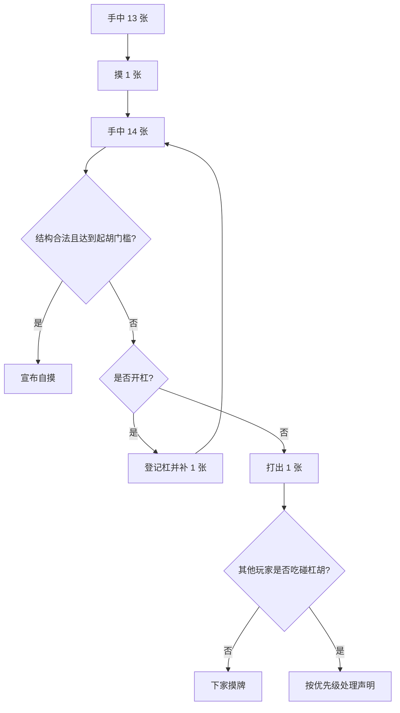
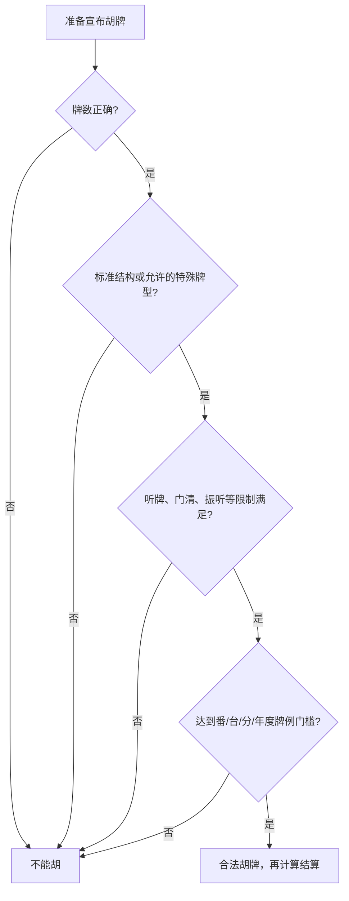

# 麻将完整入门：牌张、流程、胡牌公式与判断方法

[English version](../00-mahjong-basics.md)

麻将不是一套全球统一规则，而是一系列共享“摸一张、打一张”机制的
游戏。本页讲通用机械规则；番数、台数、起胡门槛、花牌和结算必须以具体
玩法页面为准。

## 术语与异地牌桌沟通

| 原词 | 音译/常用中文 | 必要解释 |
|---|---|---|
| `meld` | 面子 | 已组成的一组顺子、刻子或杠子；是否包含暗组要看语境 |
| `chow / chi` | 吃 / チー（qi） | 通常只能取得上家打出的牌组成顺子 |
| `pung / pon` | 碰 / ポン（pon） | 取得弃牌组成刻子 |
| `kong / kan` | 杠 / カン（kan） | 四张相同牌，通常需要补牌 |
| `fan / han` | 番（fan/han） | 港式“番”和日麻“翻”不是同一换算体系 |
| `furiten` | 振听（furiten） | 日麻中受规则限制不能荣和的状态，不等于不能自摸 |

## 1. 基础牌张

| 牌类 | 张数 | 计算 |
|---|---:|---|
| 万子 | 36 | 1-9，各 4 张 |
| 条/索子 | 36 | 1-9，各 4 张 |
| 筒/饼子 | 36 | 1-9，各 4 张 |
| 风牌 | 16 | 东南西北，各 4 张 |
| 三元牌 | 12 | 中发白，各 4 张 |
| **基础牌** | **136** | `3 x 36 + 16 + 12` |
| 花牌/季节牌 | 通常 0 或 8 | 仅在对应玩法中使用 |

144 张牌通常等于 136 张基础牌加 8 张花牌。四川玩法常去掉字牌；越南、
新加坡和马来西亚等玩法可能增加特殊牌。

## 2. 基础组合

| 名称 | 结构 | 示例 | 限制 |
|---|---|---|---|
| 顺子/吃 | 同一门连续 3 张 | 三四五万 | 字牌不能组成顺子 |
| 刻子/碰 | 相同的 3 张牌 | 三张红中 | 任意普通牌均可 |
| 杠子/杠 | 相同的 4 张牌 | 四张八筒 | 通常需要补牌 |
| 将/对子 | 相同的 2 张牌 | 两张东风 | 标准胡牌通常只有一对 |

### 标准胡牌公式

设 `M` 为顺子、刻子或杠子，`P` 为对子：

```text
标准胡牌 = M + M + M + M + P
结构数量 = 4 组面子 + 1 对将
```

通常胡牌时可见牌数为 14。每有一个杠，实际牌数多一张，但杠仍只算一组
面子，因此：

```text
胡牌实际牌数 = 14 + 杠的数量
胡牌结构仍为 = 4 组面子 + 1 对将
```

台湾和部分菲律宾 16 张麻将采用 `5 组面子 + 1 对将`，胡牌瞬间通常有
17 张实体牌。七对、国士无双、美国麻将年度牌例等特殊牌型不套用标准公式。

## 3. 一回合怎么进行



典型规则中，吃只能取得上家打出的牌；碰、杠和胡可以取得其他玩家打出的
牌。一般优先级是“胡 > 碰/杠 > 吃”，但一炮多响、截胡和距离优先必须在
开局前确认。

## 4. 胡牌合法性检查



“凑齐四组一对”只完成结构检查，不代表一定能胡。日本麻将还要有役，国标
通常要达到 8 分，港式玩法可能有最低番数，美国麻将必须符合当年的牌例卡。

## 5. 计分的三层公式

```text
牌型分 = 当前玩法承认的牌型价值
牌局价值 = 当前玩法的换算函数(牌型分, 门清/庄家/自摸等状态)
最终结算 = 支付规则(牌局价值, 放铳者, 庄家, 奖励项)
```

| 玩法 | 牌型层 | 必须使用的依据 |
|---|---|---|
| 国标 MCR | 组合分，花牌前通常至少 8 分 | 正式番种表和排除规则 |
| 港式 | 番 | 牌桌约定的番数与封顶表 |
| 日本立直 | 番 + 符 | 基本点公式、满贯以上档位 |
| 美国麻将 | 当年牌例价值 | 对应年份 NMJL 等正式牌例卡 |
| 四川/地方麻将 | 本地番数或倍数 | 明确的城市、俱乐部或平台规则 |

不能把某个玩法的番数直接代入另一个玩法的支付表。

## 6. 完整结构示例

| 组合 | 牌 |
|---|---|
| 顺子 1 | 二三四万 |
| 顺子 2 | 六七八万 |
| 顺子 3 | 三四五筒 |
| 刻子 | 三张红中 |
| 将 | 两张七条 |

它满足 `4 组面子 + 1 对将`，但是否可以宣布胡牌，仍要继续检查当前玩法的
最低番数、役、分值或年度牌例。

## 7. 开局前必须写清楚

| 项目 | 示例 |
|---|---|
| 玩法和版本 | WRC 2025 立直、2026 美国麻将、某一长沙规则表 |
| 使用牌张 | 是否有字牌、花牌、动物牌、百搭牌 |
| 起胡条件 | 役、番、台、分或年度牌例 |
| 声明规则 | 吃牌方向、一炮多响、抢杠 |
| 结算 | 庄家、自摸、放铳责任、流局 |
| 处罚 | 诈胡、相公、错误副露 |

来源：[Pagat Mahjong](https://www.pagat.com/rummy/mahjong.html)、
[World Riichi Championship](https://www.worldriichi.org/wrc-rules)、
[National Mah Jongg League](https://www.nationalmahjonggleague.org/)。

INEAN PLAY：[官网](https://ineanplay.com/) ·
[WhatsApp](https://wa.me/8617378390199) ·
[service@ineanplay.com](mailto:service@ineanplay.com)
